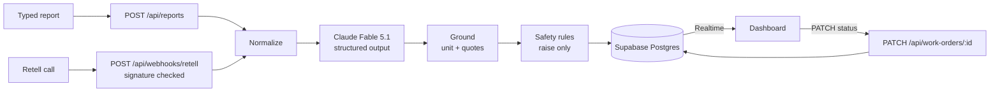

# Solvv-Tunic AI tenant line — demo

Tenants describe a maintenance problem by message or call; Claude turns each report into one or more
structured tickets, code checks the result, and a live admin dashboard shows them by urgency. Built
on the Workspark triage prototype to show the Solvv-Tunic tenant line's admin experience.

**Live:** https://workspark-maintenance.vercel.app (no login: see [Decisions](#decisions-and-trade-offs)).

**Real vs simulated.** Real: Claude triage, the safety rules, the database, live updates, and the
Retell browser call, whose transcript becomes tickets. Simulated, and labelled so on screen: Rent
Manager (tenants, properties, `SI-####` numbers in [`src/lib/demo`](src/lib/demo)), the emergency
call-out to the on-call super, booking, and the agent's reply to a message. Settings are kept in the
browser only.

## Architecture

One model call per report. The model returns `issues[]`, so a report with two problems becomes two
tickets under the same report id. Zod validates the output before anything is written. On a second
failed attempt the report is still saved with one `Other` ticket flagged for manual review, and the
safety rules still run on it, so nothing is silently lost.

## Run it locally

Requires Node 24 and pnpm 12.

1. `pnpm install`
2. `cp .env.example .env.local` and fill in the Anthropic key, the Supabase URL and keys,
   `DATABASE_URL` (session pooler string), a random `RATE_LIMIT_SALT`, and optionally the Retell
   keys and agent id for the call button. Each variable is commented in `.env.example`.
3. `pnpm db:migrate` applies `supabase/migrations/*.sql`.
4. `pnpm dev` and open http://localhost:3000.
5. Optional: `pnpm seed:demo` runs 14 realistic reports through the real pipeline;
   `pnpm eval` runs the five sample reports from the brief and rewrites `docs/walkthrough.md`.

`pnpm test`, `pnpm lint`, `pnpm typecheck` and `pnpm format:check` are what CI runs on every push
and pull request.

## How the hard cases are handled

- **Missing information (report 2).** `unit` is nullable and the prompt forbids guessing. Code
  enforces it: a unit survives only if it appears in the report and contains a digit, and every
  `source_quote` must be a verbatim substring. Anything that fails is dropped, the ticket is marked
  `needs_followup` with `missing_fields: ["unit_number"]`, and the dashboard shows an amber
  "Unit unknown" tag. Missing data never lowers priority.
- **Several problems in one report (report 3).** The schema is a list of issues, each with its own
  type, priority and quote, saved in one database transaction (`create_report_with_work_orders`).
  The drawer shows sibling tickets from the same report.
- **Understated urgency (report 4).** Priority follows the hazard, not the caller's tone. After the
  model, deterministic rules for gas odor, water near electrics, fire or smoke, flooding, and no
  heat in the cold can only raise priority. Each ticket stores `priority_source` (`model`,
  `rule:gas_odor`, …), a readable `priority_reason`, and the model's own priority beside it, so
  "why is this an emergency?" always has an answer.

## Results on the five sample reports

From `pnpm eval` against the real model (`claude-fable-5-1`, prompt `2026-11-05.3`):

| # | Report | Outcome | Decided by | Latency |
|---|---|---|---|---|
| 1 | 4B ceiling leak onto an outlet | Plumbing, **Emergency**, 4B | rule: water_electrical | 4.3 s |
| 2 | No heat, no unit given | HVAC, **High**, unit unknown, follow-up | rule: no_heat_cold | 2.6 s |
| 3 | 12C sink and hallway light | 2 tickets: Plumbing **Medium**, Electrical **Medium**, both 12C | model | 3.9 s |
| 4 | 7A "maybe gas", "probably nothing" | Gas, **Emergency**, 7A | rule: gas_odor | 3.1 s |
| 5 | 2D window, "not urgent" | Structural, **Low**, 2D | model | 2.8 s |

Full table and method: [docs/walkthrough.md](docs/walkthrough.md).

## Decisions and trade-offs

- **Structured outputs plus a rule layer.** The model handles language, which is the part code
  does badly; code handles the few cases where a miss is dangerous, which is the part a model can
  get wrong on a bad day. Rules favour false alarms over misses.
- **Postgres (Supabase) over SQLite.** Vercel functions have no persistent disk, and Realtime gives
  live updates for free. The browser gets a publishable key that RLS limits to reads; every write
  goes through a server route with the secret key.
- **No authentication.** A deliberate omission for a prototype: anyone with the URL can submit
  reports and change statuses. Mitigations are a per-IP rate limit (10 a minute, IPs hashed with a
  salt), request size caps and an Anthropic spend limit.
- **Fable at low effort** for extraction, overridable with `ANTHROPIC_MODEL`. Latency on the five
  reports was 2.6–4.3 s, fine for a synchronous request.
- **Retell for voice**, matching the tenant line's plan. The browser uses a public key restricted to
  this site's domains; calls are capped at five minutes.

## Known limitations

- Rules match words, not meaning: "no gas smell" still raises a gas emergency, and "the radiators
  are cold" may not trigger the no-heat rule.
- A unit must contain a digit to survive grounding, so a transcript reading "seven A" would be
  dropped and flagged for follow-up.
- Report text is readable by anyone who has the dashboard URL.
- Borderline priorities (report 5 Low, report 3's light Medium) rest on model judgment and can
  move by one level between runs.
- Retell call ids are stored in the `vapi_call_id` column, kept from the earlier Vapi build to avoid
  a migration in the demo.

## What I'd do next

The production tenant line replaces each simulation with the real service: Rent Manager's API for
tenants and tickets, Twilio for SMS and the on-call call-out, admin sign-in, and settings saved in
the database. A larger eval set built from real tenant calls, run nightly with a budget.

## How AI was used

Built with Claude Code from written specs, plans and test-first development, all in
[docs/superpowers](docs/superpowers) and [docs/handoff](docs/handoff). Commits carry a
`Co-Authored-By: Claude` trailer. I made the product decisions and checked the running app.
