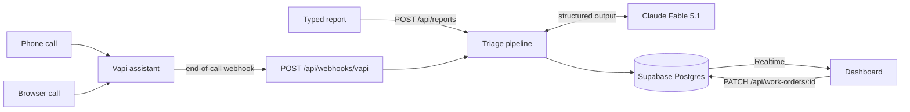

# Design: AI maintenance triage and work-order dashboard

Date: 2026-11-05 · Status: **awaiting Rafael's review** · Due: 2026-11-08
Decisions and engineering standards: `CLAUDE.md`. Original reasoning: `docs/handoff/2026-11-05-build-plan.md`.

## 1. Goal and success criteria

A tenant reports a maintenance problem by typing it, calling a phone number, or talking to the
dashboard in the browser. Claude Fable 5.1 turns the report into one or more structured work
orders, the server validates and saves them, and every open dashboard shows them within a second.
A property manager moves each ticket through New → In Progress → Done.

Done means:

- All five sample reports from the brief produce the outcomes in the table below, verified by
  `pnpm eval` against the real model, with results written to `docs/walkthrough.md`.
- The app is deployed on Vercel and works end to end: typed report, phone call, browser call,
  realtime dashboard, status updates.
- Public GitHub repo with CI green, README, ADRs, and a Loom script for Rafael to record.

| # | Report (abridged) | Expected outcome |
|---|---|---|
| 1 | 4B, ceiling leak dripping onto the outlet | 1 ticket · Plumbing · Emergency (water + electrical) · 4B |
| 2 | Heat not working, freezing, no unit given | 1 ticket · HVAC · High · unit null · needs follow-up (`unit_number`) |
| 3 | 12C, clogged sink and flickering hallway light | 2 tickets, same report · Plumbing Medium · Electrical Low or Medium · both 12C |
| 4 | 7A, "maybe gas?", "probably nothing" | 1 ticket · Gas · Emergency despite hedging · reason cites the gas rule |
| 5 | 2D, window won't close, "not urgent" | 1 ticket · Structural · Low · 2D |

## 2. Architecture



- One Next.js app (App Router, TypeScript strict, latest stable at scaffold time) on Vercel.
  Functions pinned to `icn1` (Seoul) in `vercel.json`, next to the Supabase project
  (`ap-northeast-2`). Node runtime.
- Reads use the publishable key (RLS allows `select` only): the server component for the initial
  list, the browser for Realtime and the drawer. All writes go through API routes using the
  secret key.
- Every input path calls the same `runTriage()` function. Nothing about extraction differs
  between typed reports and calls except the `source` label and the transcript formatting.

### Module layout

Each unit has one job and can be tested alone. The pipeline receives the extractor as a
parameter, so tests swap in a fake.

```
src/lib/triage/schema.ts     Zod schemas and enums for model output and tickets
src/lib/triage/prompt.ts     system prompt, PROMPT_VERSION
src/lib/triage/extract.ts    the Anthropic call; returns parsed output + model, latency, raw
src/lib/triage/ground.ts     grounding checks (unit, quotes)
src/lib/triage/rules.ts      safety escalation rules
src/lib/triage/pipeline.ts   normalize → extract → ground → rules → ticket drafts
src/lib/db/*.ts              server client (secret key, server-only), browser client, persistence
src/lib/vapi/webhook.ts      payload schema, transcript and caller extraction
src/app/api/**/route.ts      thin HTTP layers over the above
src/components/*.tsx         dashboard pieces (section 7)
scripts/eval.ts              five-report eval
scripts/vapi-setup.ts        idempotent assistant / number / public-key setup
supabase/migrations/*.sql    schema
```

## 3. Extraction pipeline

### 3.1 Steps

1. **Normalize.** Unicode NFC, strip control characters except newlines, collapse runs of
   whitespace, trim. Reject empty input. Cap typed reports at 2,000 characters and transcripts
   at 8,000.
2. **Extract.** One call to `ANTHROPIC_MODEL` (default `claude-fable-5-1`) with structured
   output (`output_config.format`, JSON schema generated from the Zod schema) and
   `output_config.effort: "low"`. No `thinking` parameter (always on for Fable). Server-side
   refusal fallback enabled (`fallbacks: "default"` with the `server-side-fallback-2026-07-01`
   beta). `max_tokens` 8,000, request timeout 45 s, SDK default retries. A `refusal` stop reason
   is treated as an extraction failure. Load the `claude-api` skill before writing this file.
3. **Validate.** Zod parse of the structured output. Then the grounding checks in 3.3.
4. **Escalate.** Safety rules in 3.4.
5. **Persist.** One `reports` row and N `work_orders` rows in a single RPC call (one
   transaction), so a report never exists without its tickets.

On an API error, refusal, or Zod failure, retry the extraction once. If the second attempt also
fails, save the report with `extraction_status = 'fallback'` and one ticket: type `Other`,
summary "Needs manual review: automatic extraction failed", needs follow-up. The safety rules in
3.4 still run on the raw report for that ticket: its floor is `High` with
`priority_source = 'fallback'`, raised to a matched rule's floor with that rule as the source.
Nothing is dropped.

### 3.2 Model output schema

```ts
{
  caller_stated_urgency: "none_stated" | "low" | "medium" | "high" | "emergency",
  caller_urgency_quote: string | null,   // caller's own words about urgency, verbatim
  issues: Array<{                        // 1–5 items
    issue_type: "Plumbing" | "Electrical" | "HVAC" | "Appliance" | "Gas"
              | "Structural" | "Pest" | "Other",
    priority: "Low" | "Medium" | "High" | "Emergency",
    priority_rationale: string,          // ≤ 200 chars, hazard-based
    summary: string,                     // ≤ 160 chars, plain language
    unit: string | null,                 // only if stated
    area: string | null,                 // e.g. "bathroom ceiling", "hallway outside unit"
    source_quote: string,                // verbatim excerpt the issue comes from
    missing_fields: Array<"unit_number" | "issue_detail">,
  }>
}
```

### 3.3 Grounding checks (enforced in code, not only in the prompt)

- **Unit.** Normalize the unit (uppercase; strip "unit", "apt", "apartment", "#", spaces) and
  require it to contain a digit and to appear in the normalized report as a whole token, so a
  stray "A" or "I" in the text cannot pass as an apartment. If it doesn't, set it to null.
  Whenever the unit is null, ensure `unit_number` is in `missing_fields`.
- **Source quote.** Must be a case- and whitespace-insensitive substring of the report. If it
  isn't, discard it, and the safety rules read the full report for that issue (err toward
  escalation).
- **Caller urgency quote.** Same substring check; null if it fails.
- `needs_followup = missing_fields.length > 0 || extraction_status = 'fallback'`.

Every correction is recorded in `grounding_notes` on the ticket (e.g. `unit_not_in_report`), so
the drawer and the walkthrough can show what the code overrode.

### 3.4 Safety rules

Pure functions over `source_quote + " " + summary` for each issue; when a report yields a single
issue the whole report stands in for the quote, so a quote that stops short of the hazard word
cannot hide it. They only raise priority. Final priority is the maximum of the model's priority
and every matched rule's floor.

| Rule | Matches (case-insensitive, word-bounded) | Floor |
|---|---|---|
| `gas_odor` | (smell, odor, odour) and "gas" in the same sentence; gas leak; rotten egg; carbon monoxide; CO alarm/detector | Emergency |
| `water_electrical` | in one sentence: a water word (water, leak, drip, flood, pouring, gushing, spraying, seeping, soaked, puddle, wet, splash) together with an electrical fixture (outlet, socket, wiring, breaker, electrical, light, light fixture, lamp, light/wall switch, electric/breaker/fuse panel, fuse box, spark). Compounds such as "water heater", "water stain", "water bill", "water pressure", "water valve" do not count as water; "electric" naming an appliance, bare "panel" and "switch" as a verb do not count as electrical | Emergency |
| `fire_smoke` | fire, flames, smoke, burning smell, sparking, or a smoke/fire alarm going off. Naming the alarm is not evidence: "smoke detector battery is low" or chirping does not match | Emergency |
| `flooding` | flooding, flooded, burst pipe, water pouring or gushing | Emergency |
| `no_heat_cold` | (no heat; heat/heater/heating/furnace/boiler/radiator + not / isn't / stopped / broken / out / off) together with (freezing, cold) | High |

Rule tests use the five sample reports verbatim plus near-miss negatives (e.g. "gas stove works
fine, but the oven light is out" must not match `gas_odor`).

When any rule matches, the ticket's `priority_source` is `rule:<name>` for the strongest match
(highest floor; ties go to the earlier row in the table) and `priority_reason` is that rule's sentence (e.g. "Possible gas odor — treated as an emergency
regardless of how the caller described it"), even if the model had already chosen the same
level. The rule is the policy of record. The model's own priority and rationale are kept in
`model_priority` and `model_rationale`, so the drawer can show "model said High, gas rule raised
it to Emergency" when that happens. With no match, `priority_source = 'model'` and the reason is
the model's rationale (`'fallback'` on the manual-review ticket, which has no model view).

### 3.5 Prompt

System prompt in `prompt.ts`, versioned (`PROMPT_VERSION = "2026-11-05.1"`), stored on every
report. Contents, written as short definitions rather than long rule lists (Fable over-applies
prescriptive prompts):

- Issue taxonomy with one line each (Structural = doors, windows, walls, ceilings, floors,
  stairs; Gas = any gas odor or gas line; Appliance = non-gas appliance faults; etc.).
- Priority rubric by hazard and consequence, not caller tone. Emergency: risk to life or major
  property damage now. High: essential service lost or damage spreading, same day. Medium:
  impairs normal use, within days. Low: minor or cosmetic.
- Split a report into separate issues only when they need separate repairs. A hazard caused by
  the same problem (a leak dripping onto an outlet) stays one issue.
- Never infer a unit. If it isn't stated, return null and list `unit_number`.
- `source_quote` and `caller_urgency_quote` must be copied verbatim.
- For call transcripts: the caller's lines are the evidence; the agent's lines are context.

## 4. Data model

```sql
reports
  id uuid pk default gen_random_uuid()
  created_at timestamptz not null default now()
  source text not null check (source in ('text','phone','web_call'))
  raw_text text not null                       -- typed text or labelled transcript
  caller_last4 text check (caller_last4 ~ '^[0-9]{4}$')
  vapi_call_id text unique                     -- idempotency for webhook retries
  caller_stated_urgency text check (caller_stated_urgency in
    ('none_stated','low','medium','high','emergency'))
  caller_urgency_quote text
  extraction_status text not null check (extraction_status in ('ok','fallback'))
  model text, prompt_version text not null
  llm_output jsonb                             -- validated output, before grounding/rules
  latency_ms integer, error text

work_orders
  id uuid pk default gen_random_uuid()
  report_id uuid not null references reports on delete cascade
  position smallint not null                   -- order within the report
  issue_type, priority, model_priority          -- checked against the enums
  priority_source text not null check (priority_source in ('model', 'fallback') or priority_source like 'rule:%')
  priority_reason text not null, model_rationale text
  unit text, area text
  summary text not null check (char_length(summary) <= 200)
  source_quote text
  missing_fields text[] not null default '{}'
  grounding_notes text[] not null default '{}'
  needs_followup boolean not null default false
  status text not null default 'New' check (status in ('New','In Progress','Done'))
  created_at, updated_at timestamptz not null default now()   -- trigger maintains updated_at

intake_events                                  -- rate limiting; no public access
  ip_hash text not null, created_at timestamptz not null default now()
```

- Indexes: `work_orders (status, priority, created_at desc)`, `work_orders (report_id)`,
  `intake_events (ip_hash, created_at)`.
- RLS enabled on all three tables. Policies: `anon` may `select` on `reports` and
  `work_orders`. No policies on `intake_events`. No insert/update/delete policies anywhere; the
  secret key bypasses RLS on the server.
- Realtime publication: `work_orders` (inserts and updates).
- Functions: `create_report_with_work_orders(report jsonb, orders jsonb)` (one transaction) and
  `check_intake_rate(ip_hash text, max_per_minute int)` (records the event and returns whether it
  is allowed, atomically). Both `security invoker` with `search_path = ''`, executable by
  `service_role` only.
- Migrations live in `supabase/migrations/` and are applied with `pnpm db:migrate`
  (a small `pg` script, `scripts/db-migrate.ts`, that records versions in
  `supabase_migrations.schema_migrations`; the Supabase CLI is not used). Load the `supabase` and
  `postgres-best-practices` skills before writing them.

## 5. API

| Route | Input | Result |
|---|---|---|
| `POST /api/reports` | `{ text }` | `201 { report, work_orders }` · `400` invalid · `429` rate limited |
| `PATCH /api/work-orders/:id` | `{ status }` | `200 { work_order }` · `400` · `404` |
| `POST /api/webhooks/vapi` | Vapi server message | `401` without secret · `200` otherwise |

- Inputs validated with Zod. Errors: `{ error: { code, message } }` with codes `invalid_input`,
  `rate_limited`, `not_found`, `unauthorized`.
- `POST /api/reports` is synchronous (the UI shows "Reading report…"), `maxDuration` 60 s.
  Rate limit: 10 per minute per IP, IP hashed with `RATE_LIMIT_SALT`.
- The dashboard's initial list is loaded in a server component; there is no list endpoint.

## 6. Voice (Vapi)

- **Assistant "Workspark Intake"**, created by `scripts/vapi-setup.ts` from a config file in the
  repo (idempotent: finds by name, updates, never touches other assistants such as "Amy").
  - First message: "Thanks for calling Workspark maintenance. What's going on?"
  - Collects the problem(s), unit number, and where in the unit; asks for a missing detail once;
    reads back a one-sentence summary; ends the call. No promises about arrival times.
  - If the caller mentions gas, smoke, fire, sparks, or flooding: tells them to move away from
    the hazard and contact emergency services, then continues intake.
  - Conversation model: `claude-haiku-5-5` if Vapi offers it, otherwise Vapi's fastest default.
    Fable is too slow for turn-taking; it does the extraction after the call.
  - `maxDurationSeconds: 120`, silence timeout 20 s. Server messages: `end-of-call-report` only.
- **Entry points:** a Vapi phone number attached to the assistant (shown on the dashboard from
  `NEXT_PUBLIC_VAPI_PHONE_NUMBER`), and a "Call intake" button using `@vapi-ai/web`.
- **Public key:** the setup script creates a dedicated public key restricted to this assistant
  and to the Vercel domain plus localhost. The org's existing unrestricted key is not deployed.
- **Webhook:**
  1. Verify the shared secret header with a constant-time compare; `401` otherwise. (Confirm
     Vapi's current header/credential mechanism in its docs when implementing.)
  2. Ignore anything but `end-of-call-report` (`200`).
  3. Extract call id, call type (`webCall` → `web_call`, phone → `phone`), last four digits of
     the caller number, and the transcript as `Caller:` / `Agent:` lines. Skip calls with no
     caller speech.
  4. Respond `200` immediately and run the pipeline in `after()`, so slow extraction never
     triggers Vapi retries. Duplicate deliveries hit the unique `vapi_call_id` and are ignored.

## 7. Dashboard

### 7.1 Layout and behaviour

Single page. Desktop: fixed-width intake panel on the left, ticket table on the right. Below
768 px the panel stacks on top and tickets render as cards.

- **Header:** product name; live indicator ("Live · updated 2s ago", switches to
  "Reconnecting…" when the Realtime channel drops).
- **Intake panel:** labelled textarea with character count; Submit (disabled with progress text
  while extracting); five sample chips that submit the brief's reports in one click; result card
  ("Created 2 tickets") or inline error with retry; "Call intake" button with live call state
  (connecting, listening, speaking, timer, end call) and the phone number beneath it.
- **Filter tabs with live counts:** All · Emergency · Needs follow-up · New · In Progress · Done.
- **Table columns:** priority badge · type (icon + label) · unit (mono) or amber "Unit unknown"
  tag · summary (with "1 of 2 from this report" when siblings exist) · source icon · status
  control · age (tabular figures).
- **Sorting:** Emergency, High, Medium, Low; newest first within each.
- **Follow-up rows:** 3 px amber left border.
- **New rows:** brief background highlight fading out over ~1.2 s; an `aria-live="polite"`
  region announces "New Emergency ticket: Gas, unit 7A".
- **Status control:** segmented New / In Progress / Done as a labelled radio group; optimistic
  update, reverts with an inline message if the PATCH fails.
- **Drawer (side sheet, Esc closes, focus trapped):** original report with the source quote
  highlighted (by string index, never injected HTML); priority explanation; caller's urgency
  quote next to the assessed priority; missing info; grounding notes; sibling tickets;
  transcript for calls; collapsible raw model output; model, prompt version, latency.
- **States:** empty ("No work orders yet. Try a sample report." with the chips), skeleton rows
  while loading, error banner with retry.

### 7.2 Visual system — "property office" (look A)

| Token | Value | Use |
|---|---|---|
| `--bg` | `#F6F5F1` | page (warm paper) |
| `--surface` | `#FFFFFF` | panel, table, drawer |
| `--ink` | `#0F172A` | primary text |
| `--ink-muted` | `#475569` | secondary text (≥ 7:1 on surface) |
| `--line` | `#E4E2DC` | borders, dividers |
| `--accent` | `#0369A1` | buttons, links, focus ring |
| `--emergency` | `#B91C1C` | Emergency badge only (white text) |
| `--followup` | `#B45309` on `#FEF3C7`, border `#D97706` | follow-up tag and row edge |
| `--done` | `#15803D` on `#DCFCE7` | Done status |

- Priority badges: Emergency solid red with warning icon; High solid ink; Medium outlined ink;
  Low muted text with a dot. Red appears nowhere else in the UI.
- Type: Fira Sans 400/500/600 for interface text; Fira Code 400/500 for unit numbers, IDs,
  times and JSON. Loaded with `next/font` (self-hosted, no layout shift). Base size 15–16 px.
- Shape: 4 px radius, 1 px borders, one shadow level (drawer only). No gradients, no blur.
- Icons: Phosphor (`@phosphor-icons/react`), regular weight, 20 px; one icon per issue type.
- Motion: drawer 200 ms in / 140 ms out; row highlight as above; all motion off under
  `prefers-reduced-motion`.
- shadcn/ui only for primitives actually used (sheet, tabs, radio group, button, textarea),
  restyled with the tokens above. Load `ui-ux-pro-max` (and `frontend-design` if installed)
  before building, and run its pre-delivery checklist.

## 8. Security and abuse limits

- Secrets only in environment variables; `.env.example` lists every variable with a comment.
  Modules that use the secret key or Anthropic key import `server-only`.
- Model output is validated (Zod), grounded (3.3), and constrained again by database checks.
  React renders all text escaped.
- Rate limit on typed reports (section 5); webhook protected by shared secret; calls capped at
  two minutes; restricted Vapi public key.
- Caller phone numbers stored as last four digits only, because the dashboard is public.
- No authentication, by decision (ADR). Anyone with the URL can submit reports and change
  statuses. Rafael sets a monthly spend limit in the Anthropic console.

## 9. Testing and evaluation

- **Unit (Vitest):** each safety rule (positive and negative cases, raise-only behaviour);
  grounding (unit present/absent/hallucinated, quote substring, urgency quote); normalization;
  fallback ticket construction.
- **Route tests:** `POST /api/reports` with a fake extractor (normal, retry then fallback,
  rate limited, invalid input); webhook (missing secret, ignored event type, duplicate call id).
- **`pnpm eval`:** runs the five reports through the real pipeline and model, asserts ticket
  count, types, priority (exact or allowed set), unit, and follow-up flag, records latency per
  report, and writes the results table to `docs/walkthrough.md`. `--persist` also saves them to
  Supabase to seed the demo. Not run in CI (costs money, needs a key).
- **CI (GitHub Actions):** typecheck, lint, unit and route tests on push and pull request.
- **Before claiming done:** click through the deployed app with `agent-browser` (typed report,
  sample chips, status change in two tabs, browser call), capture README screenshots.

## 10. Configuration and deployment

Environment variables (`.env.example`):

```
ANTHROPIC_API_KEY  ANTHROPIC_MODEL
NEXT_PUBLIC_SUPABASE_URL  NEXT_PUBLIC_SUPABASE_PUBLISHABLE_KEY  SUPABASE_SECRET_KEY  DATABASE_URL
VAPI_PRIVATE_KEY  NEXT_PUBLIC_VAPI_PUBLIC_KEY  NEXT_PUBLIC_VAPI_ASSISTANT_ID
NEXT_PUBLIC_VAPI_PHONE_NUMBER  VAPI_WEBHOOK_SECRET  RATE_LIMIT_SALT
```

- Vercel project linked to the GitHub repo: production from `main`, preview per pull request.
  Env vars added with `vercel env add` for production and preview. `DATABASE_URL` and
  `VAPI_PRIVATE_KEY` stay local (scripts only).
- Package manager pnpm. Scripts: `dev`, `build`, `test`, `lint`, `typecheck`, `eval`,
  `db:migrate`, `vapi:setup`.

## 11. Out of scope

Login and roles, multiple properties, technician assignment, notifications, editing tickets
beyond status, audio-file upload, dark mode, analytics charts.

## 12. Risks and checks during implementation

| Risk | Check / fallback |
|---|---|
| Fable latency too high for a live demo | `pnpm eval` records it; Rafael decides whether to change the env default |
| Vapi doesn't offer Claude Haiku 5.5 | Use Vapi's fastest default model; note it in the README |
| Vapi webhook auth mechanism differs from a plain secret header | Follow Vapi's current docs; keep constant-time compare |
| Supabase CLI trips on the `ñ` in the workspace path | Apply migrations with a small `pg` script instead |
| Model splits report 1 into two tickets | Prompt rule on shared causes; eval catches it |
